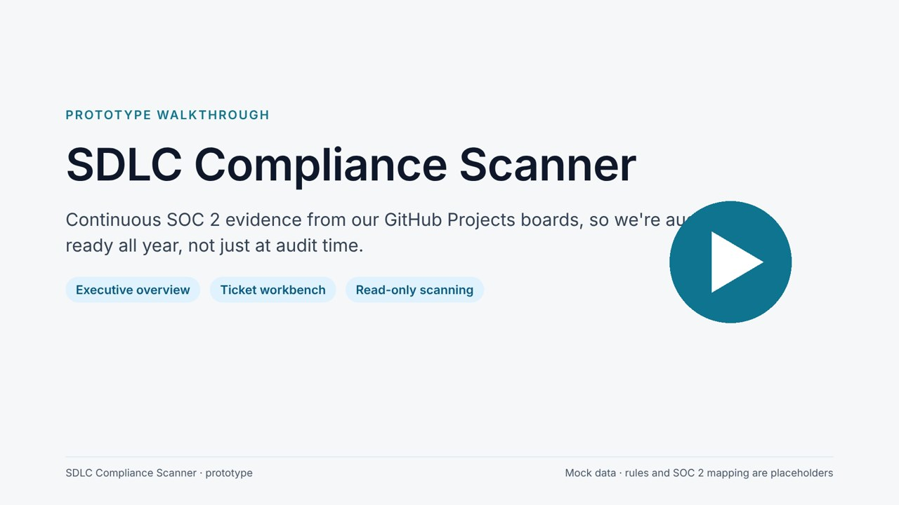
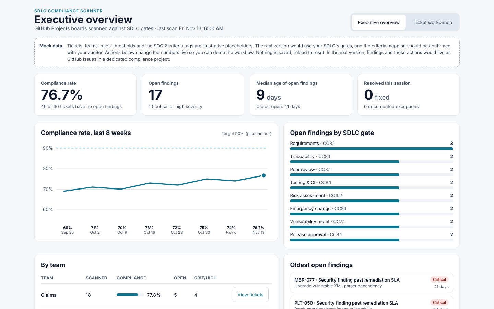
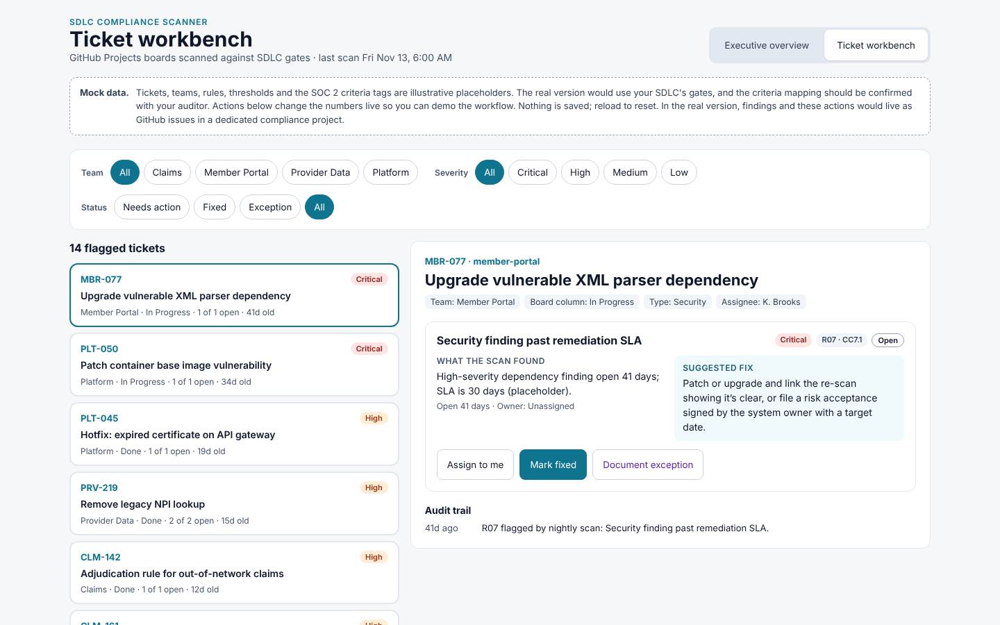

# SDLC Compliance Scanner

Our SOC 2 auditors don't just check that we have an SDLC; they test whether we followed it, ticket by ticket, over months. This project proposes a tool that checks our GitHub Projects boards against our SDLC continuously. It flags tickets that may be out of compliance, suggests a concrete fix for each, and gives leadership a live view of how teams are doing, so we're audit-ready all year instead of at audit time.

> **Status: demo with mock data.** The prototype shows how this would work in theory. Tickets, teams, rules, thresholds and SOC 2 criteria tags are illustrative placeholders, and nothing connects to GitHub yet. The next step is a formal proof of concept; see the proposal below.

## Start here (about 15 minutes)

### 1. Watch the walkthrough (5 minutes)

[](https://github.com/mikejsmith1985/sdlc-compliance-scanner/raw/main/media/SDLC-Compliance-Scanner-demo.mp4)

[Watch or download the video (MP4)](https://github.com/mikejsmith1985/sdlc-compliance-scanner/raw/main/media/SDLC-Compliance-Scanner-demo.mp4). It plays in any browser or media player. A [narration script](docs/video-script.md) is also available.

### 2. Click through the app (5 minutes)

The prototype is a single HTML file. It needs no install, no login and no internet.

- **Quickest:** open [`prototype/index.html`](prototype/index.html), click **Download raw file** (the download icon at the top right of the file), then double-click the downloaded file to open it in Edge or Chrome.
- **Or:** click **Code → Download ZIP** at the top of this page, unzip it, and open `prototype/index.html`.

Suggested click-through:

1. On **Executive overview**, click one of the **oldest open findings**.
2. In **Ticket workbench**, read what the scan found and the suggested fix, then click **Mark fixed** or **Document exception**. An exception requires a written justification.
3. Switch back to **Executive overview**. The compliance rate, trend, team table and counts update.

Nothing is saved; reload the page to reset it.

| Executive overview | Ticket workbench |
|---|---|
|  |  |

### 3. Read the POC proposal (5 minutes)

[`docs/POC-proposal.md`](docs/POC-proposal.md) covers:
- the target state: status-based gates and automated identification and reconciliation
- where AI may fix things and where people decide
- the architecture decisions to make
- known concerns
- the phased plan
- what we need to start

## What it does

| View | For | Shows |
|---|---|---|
| Executive overview | Leadership | Compliance rate and 8-week trend, open findings by SDLC gate, results by team, oldest open findings |
| Ticket workbench | Delivery leads / scrum masters | Filter by team, severity and status. Per ticket: what the scan found, suggested fix, criteria tag, actions (assign, mark fixed, document exception, reopen) and an audit trail |

## Example rules (placeholders)

These rules are examples only. The real list will come from the team's SDLC. They're defined in `rules/sdlc-rules.example.yaml`.

| ID | Rule | Gate | Criteria tag* | Severity |
|---|---|---|---|---|
| R01 | Done without a merged PR | Traceability | CC8.1 | High |
| R02 | No independent code review | Peer review | CC8.1 | High |
| R03 | Merged with failing or skipped checks | Testing & CI | CC8.1 | High |
| R04 | Missing acceptance criteria | Requirements | CC8.1 | Medium |
| R05 | Risk rating not set | Risk assessment | CC3.2 | Low |
| R06 | Emergency change without post-implementation review | Emergency change | CC8.1 | High |
| R07 | Security finding past remediation SLA | Vulnerability mgmt | CC7.1 | Critical |
| R08 | Deployed without release approval | Release approval | CC8.1 | Medium |

\*The mapping to SOC 2 Trust Services Criteria (2017 TSC, 2022 points of focus) is a working assumption. Confirm it with our security and compliance owners (whoever works with the SOC 2 auditors). The AICPA has also proposed revised criteria; the exposure draft was published in October 2026, so re-check the mapping once that's finalized.

## Planned architecture (POC)

```
Team boards: GitHub Projects v2 + linked PRs, reviews, checks, deployments
        │  read-only on team repos
        ▼
  Collector ──► dated snapshot (JSON)        ← tamper-resistant evidence over time
        │
        ▼
  Rules engine  ← rules/*.yaml (gate per board status → criteria, severity, fix template)
        │
        ▼
  Reconciler ──► compliance repo + Project   ← the only place the scanner writes
        │         (one GitHub issue per finding: open / update / close / reopen)
        ▼
  Dashboard (overview + workbench) reading the compliance Project
```

Design principles:
- **Doesn't change the teams' work.** The scanner never edits team tickets, repos or code. It writes only to its own compliance-findings repo and Project.
- **No new ticketing system.** Findings are GitHub issues, so actions happen where teams already work and the issue timeline is the audit trail.
- **Gates follow the workflow.** Each board status has its own criteria; a ticket in Refinement isn't held to Done's gate.
- **Deterministic fixes.** Suggested fixes come from templates in the rules file. AI is a later, optional layer (see the proposal for its limits).
- **Fixes are confirmed, not claimed.** A finding closes only when a later scan confirms the evidence.
- **Exceptions need a justification and an approver.** That record is itself audit evidence.
- **Flags, not verdicts.** The tool surfaces likely gaps. The auditor decides what counts as an exception.

## Roadmap

Full details are in [`docs/POC-proposal.md`](docs/POC-proposal.md).

- **Demo (done):** clickable prototype with mock data.
- **POC v1:** scheduled scan of 1–2 pilot teams; real SDLC gates as rules; findings reconciled as GitHub issues; flag only.
- **v2:** status-change triggers; an agent that drafts fixes for gaps it can prove from records, with a person approving.
- **v3:** auto-apply safe, provable fixes; human approval steps for everything else; consider LangGraph or a similar harness.

Never automated, at any phase: code reviews, testing, approvals and risk sign-offs. Those are flagged for a person.

## Security and data handling

Get approval from our security and compliance owners before you run this against real repos. In particular:
- Where the tool runs, and what token scopes it uses: read on team repos, write only on the compliance repo.
- That no secrets are committed. `.env` files are git-ignored; use `.env.example` for templates.
- That ticket content may contain sensitive data. Don't send it to outside services, including any AI model, without an approved provider.

## Repo layout

```
prototype/index.html            clickable mock-data prototype (single file, no dependencies)
media/                          walkthrough video, poster and screenshots
rules/sdlc-rules.example.yaml   example rule definitions (placeholders)
docs/POC-proposal.md            POC proposal: target state, decisions, concerns, phases
docs/video-script.md            narration script for the walkthrough video
docs/                           design notes
```
